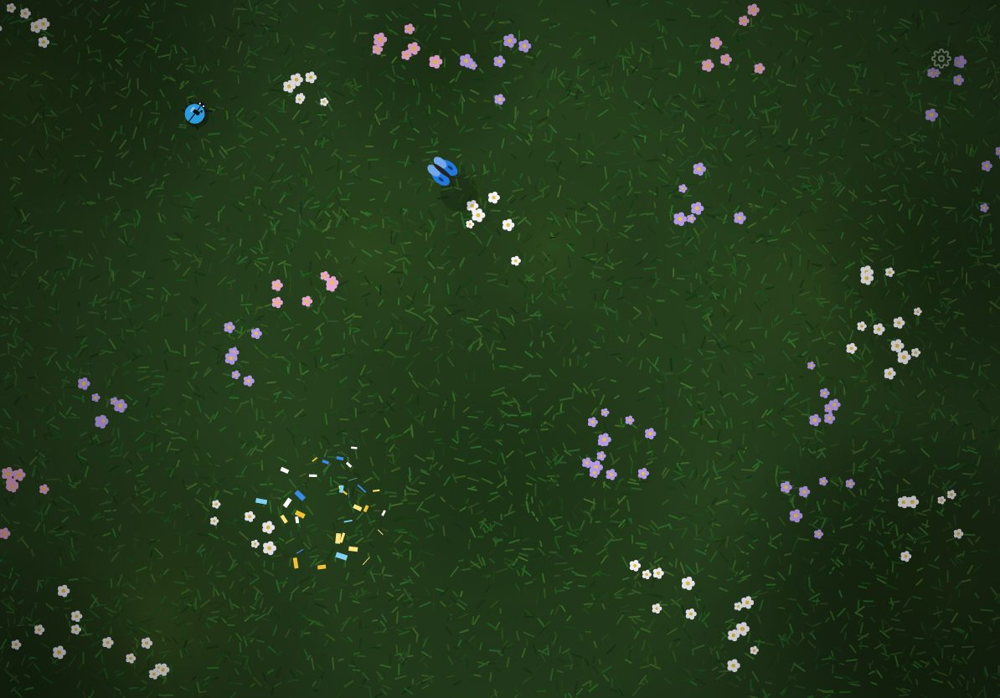

# Critters

An iPad game for cats. Small creatures run across the screen, seen from above. When a paw touches one, it squeaks and bursts. A near miss makes it run away.



- Five scenes in turn, each with its own creatures and sounds: kitchen floor (mice), meadow (butterflies, ladybugs), desert (lizards, beetles), pond (fish) and living room at night (laser dots).
- No menus, text or score on screen. All art is drawn in code and all sound is synthesized.
- Settings for scene time, creature count, speed and size, touch effects and sound. Hold the gear at the top right for one second to open them. A short tap does nothing, so a cat cannot open them.

It is a static web app with no build step and no dependencies.

## Run

```
./serve.sh
```

This serves the app on port 8421 (set `PORT` to change it). Open `http://<computer-ip>:8421` in Safari on the iPad.

On WSL2 in NAT mode, forward the port from Windows once, in an admin PowerShell. Use the LAN IP, not `0.0.0.0`, because a proxy on `0.0.0.0` also takes `127.0.0.1` and loops to itself:

```
netsh interface portproxy add v4tov4 listenaddress=<windows-lan-ip> listenport=8421 connectaddress=127.0.0.1 connectport=8421
New-NetFirewallRule -DisplayName "catapp 8421" -Direction Inbound -Protocol TCP -LocalPort 8421 -Action Allow -Profile Private
```

## Set up the iPad

1. In Safari, tap Share, then Add to Home Screen. Open Critters from the Home Screen for full screen.
2. Turn on Guided Access (Settings > Accessibility > Guided Access), set a passcode, and set Display Auto-Lock to Never.
3. In Critters, triple-click the top button and tap Start. The cat cannot leave the app, and notifications do not show.

Sound starts at the first touch, because iOS allows no sound before one.

## Code

| File | Job |
|---|---|
| `js/main.js` | Game loop, touch input, spawning, scene rotation |
| `js/creatures.js` | Creature kinds, movement and drawing |
| `js/scenes.js` | Scene backgrounds and the creatures in each scene |
| `js/effects.js` | Touch effects |
| `js/audio.js` | Touch sounds and the audio buses |
| `js/ambient.js` | Scene and creature sounds |
| `js/settings.js` | Settings and the settings panel |

To add a setting, add a field to `FIELDS` in `js/settings.js` and read `settings.<key>` where it applies.

## License

MIT
